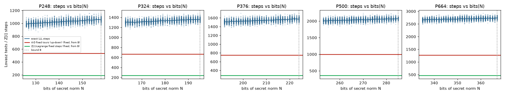
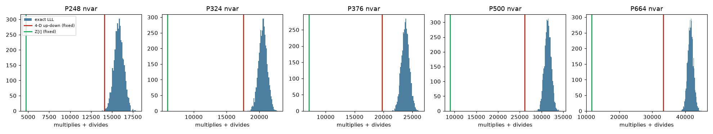
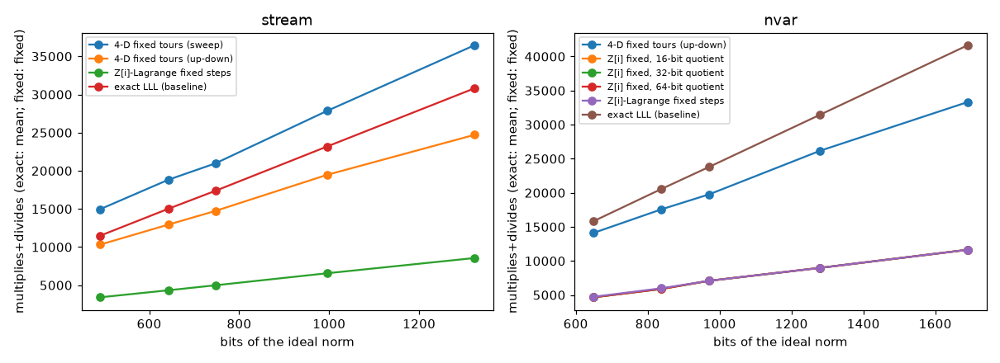
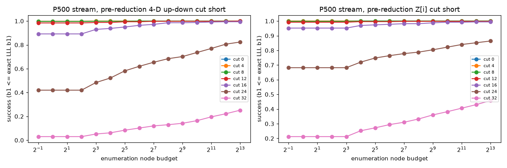

# Fixed-schedule reduction, and a fixed-budget short-vector search

Date: 2026-11-22. Research for Shekyl PRISM. Step-counting model, no
constant-time or security claim. This is not a proposal to change the
signature format.

Earlier lattice experiments showed that no reshaping of the 4-D ideal
makes exact LLL size-blind, and that only a fixed schedule flattens
the count of an exact reduction. This harness tests both reduction-side
ideas that followed: a reduction whose operation count is set by the
parameter set alone, and a short-vector search with a fixed node or
round budget. The question is whether either gives a correct short
vector at a cost that does not depend on the secret.

PRISM is the scheme of ePrint 2026/443 (Andrea Basso, Giacomo Borin,
Wouter Castryck, Maria Corte-Real Santos, Riccardo Invernizzi, Antonin
Leroux, Luciano Maino, Frederik Vercauteren, and Benjamin Wesolowski).
shekyl-prism implements it. The lattice set-up — salt, challenge
q = FS(pk, salt, msg), and a hash-chosen (H2) left ideal of norm q —
is reused from the higher-dimension harness. The deterministic
smallest ideal (D0) is not used.

**The leak that matters is bits(N), not the parameter set.** The set
is public, and within a set bits(q) is constant, so a slope across
P248–P664 is not a secret channel. The secret ideal's norm N varies
in length from key to key (signer specification section 2.1: typical
L/2+16, bound B = ⌈L/2⌉+32, L = bits(p)). Every fixed schedule and
fixed budget in this report is sized from B, never from the actual N.

**Headline.** Exact LLL on I_sec · I_q leaks about 2.0–2.1 steps per
bit of N. A fixed schedule sized from B removes that channel: the
operation trace is identical across keys, the count does not track
bits(N), and the short vector is as good as exact LLL's (for the
generic 4-D tours) or is λ₁ on every sample (for Z[i]-Lagrange).
Z[i]-Lagrange is the cheaper correct method, at about 0.28× exact
LLL's multiply-and-divide count. A fixed-budget enumeration or sieve
can cover a few tours cut from that schedule, but cannot replace a
large cut.

Python big integers are not constant-time, and step counts are not
cycles. This is algorithm-level evidence for a Rust port.

## 1. What was measured

The baseline is Cohen's integral LLL (Algorithm 2.6.7, δ = 99/100) on
the reduced-norm Gram matrix of a 4-D left ideal, the same reduction
as in the earlier harnesses.

Two fixed-schedule reductions always execute the same operations, with
branchless arithmetic selects in place of data-dependent swaps:

- **4-D fixed tours.** The same integral (d, λ) arithmetic as exact
  LLL, in a tour whose visit order is fixed (a bottom-up sweep, or an
  up-down cocktail pass). Each visit size-reduces b_k against every
  earlier vector (the rounded coefficient may be zero) and always
  runs the swap arithmetic, keeping the result with a select. The
  up-down order was the cheaper of the two 4-D schedules; the sweep
  is reported as a control.
- **Z[i]-Lagrange fixed steps.** These ideals are rank-2 lattices over
  the Gaussian integers (left multiplication by i is an isometry of
  the reduced norm). Lagrange–Gauss over Z[i] (cf. Napias 1996, LLL
  over Euclidean rings) reduces the 2-D Z[i]-basis {T, α}. Each step
  applies a Gaussian-rounded coefficient and a branchless conditional
  swap. A bounded-precision variant computes the quotient from the
  top 64, 32, 16, or 8 bits of the norm, as a fixed-width port would.

A **fixed-budget search** shortens that pre-reduction by Δ tours or
steps and then runs Schnorr–Euchner enumeration with a fixed node
budget, or a fixed number of all-pairs pairwise reductions on a
16-vector list (the sieve). A real fixed-budget implementation pads
with dummy visits; the cost is the budget, not the first hitting
time.

Success, unless noted, means the first basis vector is no longer than
exact LLL's b₁. For Z[i] we also record whether it equals λ₁ (the
shortest nonzero reduced norm), checked against an unbounded
enumeration and, on 500 lattices, against PARI's `qfminim` (0
mismatches). The hashed "operation trace" records the *schedule* of
operations, not the integer values. Values still depend on the input;
a port still needs constant-time big-integer arithmetic.

**Coverage.** All five Shekyl sets (P248, P324, P376, P500, P664).

| Panel | What | Size per set |
|-------|------|----------------|
| stream | H2 ideal of norm q | 100 keys × 40 messages = 4,000 |
| prod | I_sec · I_q at typical bits(N) = L/2 | 100 keys × 40 messages = 4,000 |
| nvar | I_sec · I_q, bits(N) = ⌈L/2⌉ + u, u uniform in 0..32 from H(sk) | 400 keys × 10 messages = 4,000 |
| nbound | the same product with bits(N) = B (the worst length a schedule sized from B must cover) | 200 keys × 10 messages = 2,000 |
| target | a fixed q, 16 H2 seeds, for fixed-size target dependence | 25 targets × 16 seeds = 400 |
| dudect_fixed / dudect_rand | one fixed key vs a fresh random key per trace, Welch t-test | 3,000 + 3,000 |
| Z[i] tail | extra first-reduced-step samples on I_q and on the product at B | 100 keys × 200 messages = 20,000 |

Simulated keys; the model is the index-4 order. Only the reduction is
measured. Key-generation's prime search, the norm-equation retry
loops, the translation to an isogeny, and secret curve arithmetic are
not measured here.

## 2. The secret-norm leak (headline test)

Within one set, keys whose secret norms have different lengths. Exact
LLL's step count tracks bits(N); the fixed schedules, sized from B,
do not. Minimum detectable \|r\| at α = 0.05, power 0.8, is about
2.8/√n ≈ 0.044 on 4,000 traces.

| Set | bits(N) | B | Exact LLL, steps / bit of N | r | η² vs bits(N) | Z[i] T from B | Z[i] λ₁, nvar / at B | 4-D up-down T from B | 4-D λ₁, nvar / at B |
|-----|---------|---|------------------------------|---|---------------|---------------|----------------------|----------------------|---------------------|
| P248 | 126–158 | 158 | 2.115 | 0.489 | 0.245 | 189 | 1.000 / 1.000 | 134 | 0.9965 / 0.9955 |
| P324 | 163–195 | 195 | 2.021 | 0.434 | 0.194 | 239 | 1.000 / 1.000 | 167 | 0.9952 / 0.9940 |
| P376 | 192–224 | 224 | 2.081 | 0.410 | 0.174 | 283 | 1.000 / 1.000 | 188 | 0.9938 / 0.9965 |
| P500 | 253–285 | 285 | 2.008 | 0.340 | 0.122 | 359 | 1.000 / 1.000 | 249 | 0.9972 / 0.9960 |
| P664 | 335–367 | 367 | 2.052 | 0.309 | 0.105 | 465 | 1.000 / 1.000 | 317 | 0.9952 / 0.9925 |

Exact LLL's slope is about 2.0–2.1 steps per bit of N on every set
(p ≪ 10⁻⁸⁰). That is many times the detectable threshold. The earlier
"about 2.0 steps per bit on the secret product" law, pointed at the
secret norm rather than at the public parameter set, is the same
channel.

Each fixed schedule has a single operation trace per set (CV 0 of the
count). An *early exit* from the same algorithm — stopping when the
basis first looks reduced — would still correlate with bits(N)
(r ≈ 0.27–0.47). The schedule has to be run in full.

The 4-D up-down tour reaches an LLL-reduced basis on every row, and
its λ₁ rate matches exact LLL's own (exact LLL itself finds λ₁ on
about 99.3–99.7% of these lattices; dim-4 LLL is not a shortest-vector
oracle). Z[i]-Lagrange finds λ₁ on every nvar and nbound sample,
including at bits(N) = B, and PARI agreed on all 500 cross-check
lattices.

## 3. Fixed-versus-random key (dudect-style)

A Welch t-test of 3,000 traces of one fixed key against 3,000 traces
of fresh random keys, per set. dudect flags \|t\| > 4.5. The smallest
mean gap in exact-LLL steps that would cross that threshold is 4.4
to 6.9 steps (62 to 97 multiplies).

| Set | Fixed key, bits(N) | Exact LLL, mean steps fixed / random | t | MDE at \|t\| = 4.5 | Z[i] traces | Z[i] t |
|-----|--------------------|--------------------------------------|---|---------------------|-------------|--------|
| P248 | 156 (near B = 158) | 1056.3 / 1027.5 | 29.53 | 4.40 | 1 | 0 |
| P324 | 166 (near the short end) | 1304.7 / 1331.8 | −24.60 | 4.96 | 1 | 0 |
| P376 | 211 | 1547.9 / 1541.3 | 5.53 | 5.32 | 1 | 0 |
| P500 | 266 | 2035.0 / 2039.4 | −3.29 | 6.02 | 1 | 0 |
| P664 | 351 (typical) | 2698.3 / 2697.2 | 0.73 | 6.90 | 1 | 0 |

Exact LLL is flagged when the fixed key's N-length sits away from the
population mean, and is not flagged when it sits near the typical
length: within one length, residual variance can hide a single key.
The regression against bits(N) in §2 is the cleaner test of the
channel. The Z[i] schedule has one trace and t = 0 on every set. A
t-test on the real Rust code still belongs after stages 2 to 4.

## 4. Cost against exact LLL

"mul" is multiplies plus divides in the integer arithmetic. For exact
LLL this varies with the input (CV about 2–4%); for a fixed schedule
it is constant. Cost ratios are against the exact-LLL mean and against
its 99.9th percentile. T is the per-set tour or step count, sized from
the observed maximum on the calibration sample (nvar + nbound + the
Z[i] tail, for the secret product; stream + the stream tail, for I_q).

### Secret product with varied bits(N), schedule from B (4,000 rows; T also covers the 2,000 rows at B and the tail)

| Set | Exact LLL, mean steps (CV) | Exact mul (CV) | 4-D up-down T, mul, vs mean / p999 | Z[i] T, mul, vs mean / p999 |
|-----|----------------------------|----------------|------------------------------------|-----------------------------|
| P248 | 1025.0 (0.039) | 15,821 (0.036) | 134, 14,100, 0.891 / 0.801 | 189, 4,735, 0.299 / 0.269 |
| P324 | 1331.5 (0.033) | 20,552 (0.031) | 167, 17,565, 0.855 / 0.781 | 239, 5,985, 0.291 / 0.266 |
| P376 | 1541.8 (0.031) | 23,799 (0.028) | 188, 19,770, 0.831 / 0.765 | 283, 7,085, 0.298 / 0.274 |
| P500 | 2038.2 (0.027) | 31,469 (0.025) | 249, 26,175, 0.832 / 0.772 | 359, 8,985, 0.286 / 0.265 |
| P664 | 2697.8 (0.023) | 41,650 (0.021) | 317, 33,315, 0.800 / 0.754 | 465, 11,635, 0.279 / 0.263 |

Z[i] is cheaper and uses narrower intermediates (about 40% the bit
width of LLL's Gram–Schmidt integers). A rough fixed-width model,
count × (⌈W/64⌉)² limb products, puts Z[i] at about 4.5–4.9% of exact
LLL's 99.9th-percentile cost, and 4-D up-down at about 75–80% of it.
That is a limb-count model, not a cycle count.

### Challenge ideal I_q (public; cost reference only, 4,000 rows)

Exact LLL costs about 1.51 steps per bit of q, matching the earlier
harnesses. The 4-D sweep is a more expensive fixed control (about
1.18–1.30× exact mean). Up-down is 0.80–0.90×; Z[i] is 0.28–0.30×,
with λ₁ on every stream row.

| Set | Exact LLL, mean steps (CV) | 4-D up-down T, vs mean | Z[i] T, vs mean | Z[i] λ₁ |
|-----|----------------------------|------------------------|-----------------|---------|
| P248 | 744.3 (0.041) | 98, 0.898 | 136, 0.297 | 1.000 |
| P324 | 973.6 (0.036) | 123, 0.862 | 173, 0.289 | 1.000 |
| P376 | 1124.9 (0.033) | 140, 0.848 | 199, 0.287 | 1.000 |
| P500 | 1500.8 (0.029) | 185, 0.840 | 262, 0.283 | 1.000 |
| P664 | 1995.5 (0.025) | 235, 0.802 | 342, 0.278 | 1.000 |

A product panel at a single typical length bits(N) = L/2 (not the
leak test) gives the same cost ratios as nvar, as expected.

## 5. Bounded-precision quotients

The Z[i] coefficient is the Gaussian rounding of h / nrd(u). Computing
it from the top 64, 32, or 16 bits of the norm, instead of an exact
division, produced the same reduced vector as exact Z[i] on every nvar
and nbound row, at the same or a nearly identical step count (for
example 186 versus 189 at P248; identical T from P376 up). An 8-bit
quotient reached the reduced fixed point on about 99.8% of rows and
failed on the rest, so it is under the 99.9% bar and no schedule is
claimed for it.

This is a more encouraging bounded-precision hint than Q256 / PREC_256
in the earlier experiments, which failed two times in three. It is
still only a quotient-width test in the Z[i] recurrence, not a
complete fixed-width LLL.

## 6. Fixed-budget enumeration and sieve

500 traces per set, on I_q and on the varied-N product. The
pre-reduction is the fixed schedule of §4, cut Δ tours or steps short.
N₉₉₉ is the smallest node budget (0, 1, 2, …, 8192) at which at least
99.9% of rows had already found a vector no longer than exact LLL's
b₁; a blank means that bar was not met at 8,192 nodes.

| Pre-reduction cut short by Δ | Typical result at 99.9% |
|------------------------------|-------------------------|
| Δ = 0 (full schedule) | Z[i]: already has λ₁ (budget 0). 4-D up-down: a budget of 8–16 nodes covers the few rows whose b₁ is not yet as short as exact LLL's. The sieve's list already holds a good vector (0 extra rounds). |
| Δ = 8 | Often still reachable with a modest budget (0–128 nodes, occasionally more). |
| Δ = 16 and above | Frequently under 99.9% even at 8,192 nodes. The 4-D tree after a large cut is no longer tiny. |

A fixed-budget search is a small safety margin after a slightly short
pre-reduction, not a replacement for the schedule. There is no winning
"enumerate instead of reducing" cost on these lattices: once the
schedule has been run, the short vector is already in hand, and
enumeration adds almost nothing; if the schedule is cut substantially,
enumeration does not reliably finish the job inside a small fixed
budget.

## 7. Target dependence, and what a public I_q does not leak

On the target panel (a fixed q, 16 H2 ideal seeds, 25 targets), exact
LLL's η² versus the target is 0.03–0.09, in line with the earlier H2
finding that a fresh hash-chosen ideal flattens target dependence to
chance. The fixed schedules have one operation trace, so the *count*
cannot depend on the target. An early exit would still vary (η²
0.04–0.09); again, the schedule has to be run in full. I_q itself is
public, so even a varying count on the challenge lattice would not be
a secret channel. The secret-touching reduction is the product in §2.

## 8. Limits

- The model is the index-4 maximal order with simulated keys, not the
  live signer.
- Only the reduction is modelled. Key generation's search for a
  prime-norm equivalent, signing's intersection, the norm-equation
  search (17-bit generators, 20,000 steps, 400,000-pass budget, two
  uncapped inner loops), the translation to an isogeny, and curve
  arithmetic with secret scalars are unmeasured, and those retry loops
  are likely far larger channels than this step count.
- Step counts and multiply counts are not cycles. Python and Sage are
  not constant-time. The hashed traces confirm a data-independent
  *schedule* of operations; the integer values still vary, and a port
  must use constant-time arithmetic.
- Z[i]-Lagrange uses that i acts on these left ideals by an isometry.
  That is true of the PRISM quaternion algebra (−1, −p) with p ≡ 3
  (mod 4), and is a stronger use of the algebra than a generic 4-D
  tour. The 4-D up-down schedule does not need that structure and is
  the fallback if a later layer leaves the Z[i] lattice.
- D0 was not used. The response ideal is H2 with a secret seed, which
  is uniform among the ideals of norm q.

## 9. Conclusion

A fixed schedule sized from the public bound B gives a correct short
vector at a cost that does not depend on the secret norm. Exact LLL
does not: it leaks about 2.0–2.1 steps per bit of N, visible both as a
regression on 400 keys and, when a key's N-length sits away from the
typical value, as a dudect t-test on 3,000 traces.

Of the two schedules, Z[i]-Lagrange is the one to port first: 100% λ₁
on every sample, including at B, at about 0.28× exact LLL's
multiply-and-divide count (and about 5% in a fixed-width limb model),
with a 16-bit quotient already enough. A generic 4-D up-down tour also
works, at about 0.80–0.89×, with the same λ₁ rate as exact LLL. A
fixed-budget enumeration or sieve is only a thin safety margin; it is
not a substitute for the schedule. The schedule must be run in full:
stopping early re-opens the bits(N) channel.

The next measurement that matters is not another lattice reshaping. It
is this reduction, in Rust, with constant-time arithmetic, and a
t-test on the real signing path — together with the unmeasured retry
loops, which this harness does not touch.
