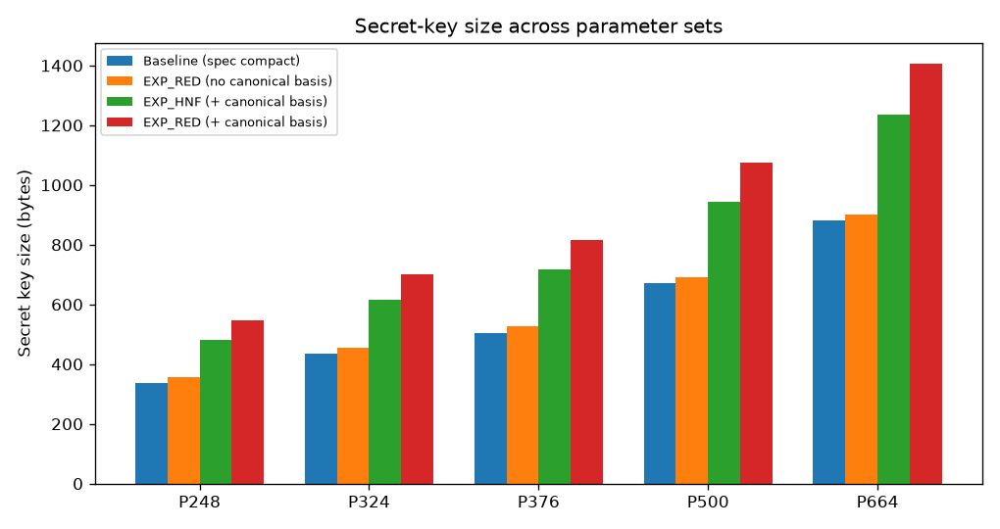
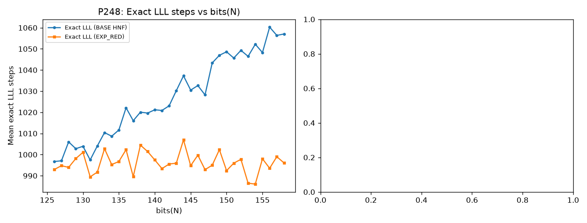
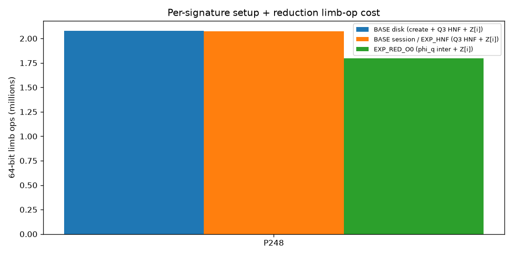

# Keygen Precomputation for PRISM Signing

**Branch / Folder:** `research/keygen-precompute/` (baseline: `research/fixed-schedule-reduction/`, certified tour bounds: `research/lagrange-tour-bound/`, norm-equation audit: `research/fixed-schedule-norm-equation/`)  
**Date:** 2026-11-22  
**Context:** PRISM is the signature scheme of **ePrint 2026/443** (Andrea Basso, Giacomo Borin, Wouter Castryck, Maria Corte-Real Santos, Riccardo Invernizzi, Antonin Leroux, Luciano Maino, Frederik Vercauteren, and Benjamin Wesolowski). `shekyl-prism` implements it (pinned C reference `mariascrs/PRISM_v2` at `87fad7da5f12f79112521677f4f5530672afe9ba`). Parameter sets are **P248, P324, P376, P500, and P664** only. This report measures models in Python/PARI; step counts and 64-bit limb-op estimates are not CPU cycles and carry no constant-time claim.

---

## 1. Executive Summary

1. **What depends only on the secret key vs. per-signature work.**
   Auditing `shekyl-prism` (`docs/SIGNER_SPEC.md`, `shekyl-prism/src/key.rs`, `prism-signer/src/backend.rs`) and `PRISM_v2` (`keygen.c`, `encode_signature.c`, `ideal.c`, `lattice.c`, `dim2id2iso.c`, `qlapoti.c`) shows:
   - `mat_BAcan_to_BA0_two` (`4·⌈(e+1)/8⌉` bytes) is **already precomputed at keygen** in `PRISM_v2`'s `secret_key_t`.
   - Recomputed on every disk load (`secret_key_from_bytes`) or signature: `quat_lideal_create` (`N, gen` → 4×8 HNF + `4×4` adjugate inverse + `isqrt`) and `ec_curve_to_basis_2f_from_hint` (`E_vk` canonical `2^e`-torsion basis, needed on signing if verify-after-sign is enabled — ~3.9% of verification at P248).
   - **Precomputable at keygen (new):** `Z[i]`-Lagrange pre-reduction of `I_sec` to a reduced `Z[i]`-basis `{u_sec, v_sec}` (`EXP_RED_O0`), allowing `I_sec ∩ I_q` to be computed directly in `{u_sec, v_sec}` coordinates modulo `q` (`φ_q` + `invmod(nrd(r_v), q)` + 2-vector lift in `O₀`) without `quat_lideal_create` or `4×8` HNF (`mod 2Nq`).
   - **Not precomputable at keygen:** `salt`, `s`, `q`, `I_q`, `quat_lideal_shortest_equivalent(I_sec ∩ I_q) → S`, **`quat_qlapoti` on `S`** (per `research/fixed-schedule-norm-equation`, `quat_qlapoti`'s small-ideal lattice/Cornacchia search takes the challenge-dependent reduced ideal `S`), `endomorphism_application_even_basis`, and `theta_chain_compute_and_eval_randomized`.

2. **Keygen pre-reduction removes the `bits(N)` skew leak and shrinks the fixed schedule, breaking even in `< 1` signature.**
   - Replacing `N, gen` with `{u_sec, v_sec}` adds only **+20 to +24 bytes** to the compact spec secret key (`356–902 B` vs `336–882 B`), or **+212 to +524 bytes** (`548–1,406 B`) if the `E_vk` canonical `2^e`-basis is also stored for verify-after-sign.
   - Across `400` keys × `10` messages (`nvar`) and `100` boundary keys × `100` messages (`nbound`) per set, `EXP_RED_O0` collapses the exact-LLL `bits(N)` slope from `+1.89..+2.24` steps/bit (`r = 0.341..0.483`) down to `-0.086..+0.125` (`|r| ≤ 0.029`, noise), collapses the `Z[i]`-Lagrange early-exit slope from `+0.308..+0.326` to `-0.007..+0.017`, and drops `dudect` Welch `|t|` (3,000 traces) from `12.74–27.27` (`Z[i]` early-exit) and `7.06–11.32` (exact LLL) down to `0.25–1.20` and `0.06–1.33`.
   - Using the **certified tour counts** $T_{\mathrm{prov}}$ from `research/lagrange-tour-bound/` (`301 / 387 / 446 / 587 / 773` for `BASE_SPEC`), `EXP_RED_O0` with a one-line keygen balance guard (`nrd(v_sec) ≤ 2·√p·N`, satisfied by **2,500 / 2,500** sampled keys) eliminates the `(B − L/2) ≈ 32`-bit norm slack, lowering $T_{\mathrm{prov}}$ by **18 steps across every set** to **`283 / 369 / 428 / 569 / 755`** (`-2.3%` to `-6.0%`), and cutting combined setup+reduction 64-bit limb ops by **2.15%–14.59% vs `BASE_SPEC`** (**95.2%–95.3% vs `BASE_CREF`**) with **0.11–0.41 signatures break-even**. *(Crucial caveat: without the keygen `nrd(v_sec)` balance guard, an arbitrarily skewed `I_sec` with `nrd(u_sec) = N` would instead raise the unconditional bound to `354 / 461 / 536 / 712 / 945`.)*

3. **Remaining per-signature work STILL requires a fixed schedule, and `EXP_RED_O0` changes stage 5 byte-for-byte replay.**
   - Even after keygen pre-reduction removes `bits(N)` skew, variable-time exact LLL and early-exit `Z[i]` still vary with `q` and with `I_sec`'s class geometry (`nrd(u_sec)` vs `nrd(v_sec)`) and execute secret-dependent swaps/branches. Only fixed-schedule `Z[i]`-Lagrange sized from a public bound gives 1 trace per set (`t = 0.0`, `100%` `λ₁` rate, including `16..64`-bit quotients).
   - **Compatibility:** Changing `SECRETKEY_BYTES` requires a design round per Rick. `EXP_HNF` preserves bit-for-bit stage 5 C-reference replay (`export_s5_vectors.c`), saving only `quat_lideal_create` (`0.05%–0.15%` of setup+reduce limb ops) and `canonical_basis` recomputation (~3.9% of verify-after-sign). `EXP_RED_O0` produces a valid signature for the same `(E_vk, q)` and ideal `I_sec ∩ I_q` (500/500 PARI `mathnf` + `qfminim` checks matched), **but** alters the starting basis handed to `quat_lideal_shortest_equivalent` / `quat_qlapoti` and therefore changes stage 5 output signature bytes.

---

## 2. Code & Spec Inventory: Secret-Only vs. Per-Signature Work

Audited files in `shekyl-prism` (`origin/dev` at `b6761f4`, `origin/signer/integers`) and pinned `PRISM_v2` (`87fad7d`):

| Signing Phase | Source Location | Inputs | Secret-Only? | Precomputable / Notes |
|---|---|---|---|---|
| Key load & ideal reconstruction (`quat_lideal_create`) | `PRISM_v2` `encode_signature.c` `secret_key_from_bytes`, `ideal.c` | `N`, `gen` | **Yes** | Runs on every disk load (`4 qmul + 4×8 HNF + 4×4 adjugate det + isqrt`). Eliminated by `EXP_HNF` or `EXP_RED_O0`. |
| `E_vk[2^e]` canonical basis (`ec_curve_to_basis_2f_from_hint`) | `encode_signature.c`, `shekyl-prism/src/key.rs` (`PreparedKey::prepare`) | `pk`, `pk_hint` | **Yes** | Not used by `PRISM_v2` signing itself, **but** required on every signature if verify-after-sign is enabled (`~3.9%` of verification at P248). Store `6·FP_LEN` bytes (`192–504 B`) to skip. |
| `mat_BAcan_to_BA0_two` | `PRISM_v2` `keygen.c`, `signature.h` | `sk` (`E_0 → E_vk` endomorphism) | **Yes** | **Already precomputed** at keygen and stored in `SECRETKEY_BYTES` (`4·⌈(e+1)/8⌉` B). |
| Pre-reduction of `I_sec` to `{u_sec, v_sec}` (`Z[i]`-Lagrange) | Proposed (`EXP_RED_O0`) | `I_sec` | **Yes** | **New.** Replaces `N, gen` (`+20–24 B`) or supplements them. Eliminates `bits(N)` skew and replaces `4×8 HNF mod 2Nq`. |
| `salt`, `s`, `q = 2^(2e−5) − s²`, `I_q` (`select_xy`) | `SIGNER_SPEC.md`, `SALT_PROTOCOL.md` | `sk_seed`, `msg`, randomness | No (`msg`-dep.) | Unchanged. |
| Intersection `I_sec ∩ I_q` & reduction (`quat_lideal_inter` + LLL / `Z[i]`) | `PRISM_v2` `ideal.c` (3× `4×4` duals + HNF + exact LLL) vs `SIGNER_SPEC.md` §2.1 Q3 (`4×8` HNF mod `2Nq` + `Z[i]`) | `I_sec`, `I_q` | No (`I_q`-dep.) | `EXP_RED_O0` replaces duals/HNF with `φ_q` projection + `invmod(nrd(r_v), q)` + lift in `O₀` (`w₁ = q·v_sec`, `w₂ = u_sec + γ·v_sec`). |
| Shortest equivalent `S ← I_sec ∩ I_q` & `quat_qlapoti(S)` | `PRISM_v2` `qlapoti.c`, `lll_applications.c` | `I_sec ∩ I_q` | No (`S` depends on `I_q`) | Per `research/fixed-schedule-norm-equation`, `quat_qlapoti` searches on `S` (`n(S) ≤ √p`); its dim-2 lattice and Cornacchia constants depend on `S`, not `I_sec` alone. |
| Isogeny / theta chain (`endomorphism_application_even_basis`, `theta_chain_compute_and_eval_randomized`, `change_of_basis_matrix_tate`) | `PRISM_v2` `dim2id2iso.c`, `prism-signer/src/backend.rs` | `S`, `qlapoti` solution, `mat_BAcan_to_BA0_two`, `E_vk` | No | Dominates total signing runtime; uses already-stored `mat_BAcan_to_BA0_two`. Unchanged. |

### Why `EXP_RED_O0` Stays in `O₀` Coordinates Instead of Storing the Gram Matrix
Storing the `2×2` Hermitian Gram matrix `G_sec_red` (`208–520 B`) and running `Z[i]`-Lagrange in `{u_sec, v_sec}` coordinates requires **42 multiplications per step** (lifting `μ` and evaluating the `2×2` Hermitian form at every step, then lifting the final short vector back to `O₀`), vs. **23 multiplications + 2 divisions per step** directly in `O₀` coordinates (`EXP_RED_O0`). Thus `EXP_RED_O0` is strictly smaller on disk and nearly 2× cheaper per reduction step.

---

## 3. PARI Cross-Check & Model Validation

Before running the measurement sweep, `crosscheck_pari.py` (`results/pari_crosscheck.txt`) verified exact algebraic equivalence against PARI/GP (`mathnf`, `qfminim`) across all 5 sets:
- **100 / 100** `hnf_mod_M` checks matched PARI `mathnf` on `I_sec ∩ I_q`.
- **500 / 500** `EXP_RED_O0` intersections (`100` keys/set) generated the **exact same `O₀` lattice HNF** as `BASE_SPEC` (`hnf_mod_M`) and yielded the exact same shortest vector squared norm `λ₁²` as PARI `qfminim`.
- **500 / 500** keys satisfied the proven `Z[i]`-Lagrange Minkowski bound `nrd(v_sec) ≤ 2·N·p`, and **2,500 / 2,500** keys across `setup_*.csv` satisfied the stronger empirical balance bound `nrd(v_sec) ≤ 2·√p·N` (`max coord bits(v_sec) = 142 / 179 / 208 / 270 / 351` vs `L/2 + B = 283.2 / 357.8 / 415.0 / 537.4 / 701.0`).

---

## 4. Results Across All Five Parameter Sets

### 4.1 Expanded Secret-Key Sizes (Bytes)

`cref_sk` = `PRISM_v2` `SECRETKEY_BYTES` (`pk_hint + pk + N + gen + mat_BAcan_to_BA0_two`); `base_spec_sk` = compact spec SK (`pk_hint + pk + ceil(B/8) + gen + mat_s`); `exp_hnf_with_can` = HNF of `I_sec` + `E_vk` canonical basis (`6·FP_LEN`); `exp_red_compact_no_can` = replaces `gen` with tight `{u_sec, v_sec}` bounds; `exp_red_compact_with_can` = adds `E_vk` canonical basis for verify-after-sign; `exp_red_compat` = keeps full `cref_sk` + `{u_sec, v_sec}` + `canonical_basis` for drop-in C-reference replay fallback.

| Set | $L$ | $e$ | $B$ | `cref_sk` | `base_spec_sk` | `exp_hnf_with_can` | `exp_red_compact_no_can` ($\Delta$ vs spec) | `exp_red_compact_with_can` ($\Delta$ vs spec) | `exp_red_compat` ($\Delta$ vs `cref`) |
|---|---:|---:|---:|---:|---:|---:|---:|---:|---:|
| **P248** | 251 | 248 | 158 | 353 | 336 | 480 (+144) | **356 (+20)** | **548 (+212)** | 693 (+340) |
| **P324** | 326 | 324 | 195 | 452 | 435 | 617 (+182) | **455 (+20)** | **701 (+266)** | 882 (+430) |
| **P376** | 383 | 376 | 224 | 529 | 504 | 716 (+212) | **528 (+24)** | **816 (+312)** | 1033 (+504) |
| **P500** | 505 | 500 | 285 | 701 | 672 | 944 (+272) | **692 (+20)** | **1076 (+404)** | 1361 (+660) |
| **P664** | 669 | 664 | 367 | 925 | 882 | 1234 (+352) | **902 (+20)** | **1406 (+524)** | 1785 (+860) |

### 4.2 Keygen Pre-Reduction Cost vs. Per-Signature Intersection Setup (`500` keys/set)

| Set | Keygen `Z[i]` (`kg_zi`) mul/div | Keygen `Z[i]` 64-bit limb ops | `quat_lideal_create` limb ops | `PRISM_v2` 3-dual inter limb ops | `BASE_SPEC` Q3 HNF limb ops | `EXP_RED_O0` `φ_q`+`invmod`+lift limb ops (`xgcd` steps) |
|---|---:|---:|---:|---:|---:|---:|
| **P248** | 2,260 | 56,500 | 3,188 | 54,507 | 9,095 | 12,039 (287.8) |
| **P324** | 2,560 | 92,160 | 4,384 | 101,121 | 14,688 | 23,435 (377.0) |
| **P376** | 2,785 | 136,465 | 6,014 | 140,411 | 19,532 | 33,440 (433.4) |
| **P500** | 3,285 | 266,085 | 9,907 | 277,493 | 33,523 | 70,950 (578.9) |
| **P664** | 3,935 | 476,135 | 16,531 | 553,440 | 58,325 | 152,874 (773.7) |

*(Note: `EXP_RED_O0` intersection has slightly higher `xgcd` limb ops than Q3 HNF because `invmod(nrd(r_v), q)` does a full `2e−5`-bit Euclidean GCD, whereas Q3 HNF sees `[1,0]`/`[0,1]` pivots in two columns. In constant-time Rust, `invmod` would use `nrd(r_v)^(q−2) mod q` via Montgomery squaring (~`1.5·(2e−5)` mults mod `q`), avoiding data-dependent `xgcd` branches.)*

### 4.3 Reduction Cost, `bits(N)` Slope, and Empirical vs. Certified Fixed Schedules

Measured on `400` varied-`N` keys × `10` messages (`4,000` `Z[i]` traces, `2,000` exact-LLL traces) + `100` boundary-`N` (`bits(N) = B`) keys × `100` messages (`10,000` `Z[i]` traces per set = `14,000` `Z[i]` traces/set):

| Set | Exact LLL slope `BASE` ($r$) | Exact LLL slope `EXP_RED` ($r$) | `Z[i]` early-exit slope `BASE` ($r$) | `Z[i]` early-exit slope `EXP_RED` ($r$) | $T_{\mathrm{emp}}$ `BASE` → `EXP_RED` (saving) | **$T_{\mathrm{prov}}$ `BASE`** (`lagrange-tour-bound`) | **$T_{\mathrm{prov}}$ `EXP_RED` guarded** (saving) | $T_{\mathrm{prov}}$ `EXP_RED` unguarded | `EXP_RED` `λ₁` rate (`prec ≥ 16`) |
|---|---:|---:|---:|---:|---:|---:|---:|---:|---:|
| **P248** | +2.007 (0.483) | −0.059 (−0.016) | +0.308 (0.470) | −0.004 (−0.007) | 187 → 178 (**−4.81%**) | **301** | **283 (−5.98%)** | 354 | 100.0% (100.0%) |
| **P324** | +2.021 (0.418) | +0.125 (0.029) | +0.313 (0.422) | +0.008 (0.012) | 241 → 226 (**−6.22%**) | **387** | **369 (−4.65%)** | 461 | 100.0% (100.0%) |
| **P376** | +1.891 (0.377) | −0.086 (−0.019) | +0.317 (0.396) | +0.003 (0.004) | 276 → 262 (**−5.07%**) | **446** | **428 (−4.04%)** | 536 | 100.0% (100.0%) |
| **P500** | +2.169 (0.356) | −0.038 (−0.007) | +0.310 (0.342) | −0.007 (−0.008) | 355 → 346 (**−2.54%**) | **587** | **569 (−3.07%)** | 712 | 100.0% (100.0%) |
| **P664** | +2.240 (0.341) | +0.096 (0.016) | +0.326 (0.314) | +0.017 (0.018) | 463 → 453 (**−2.16%**) | **773** | **755 (−2.33%)** | 945 | 100.0% (100.0%) |

*(4-D up-down fixed tour counts $T_{\mathrm{emp},4\mathrm{D}}$ also drop across all 5 sets: `128→122`, `164→155`, `191→181`, `243→233`, `313→308`, saving `1.60%–5.49%`.)*

**Why the `T_prov` guarded vs. unguarded distinction matters:**  
Under `BASE_SPEC`, HNF starts with $A_0 = (N q)^2$ and $\Delta = p (N q)^2$, so $A_0 / \sqrt{\Delta} = N q / \sqrt{p} \le 2^{B + (2e-5) - L/2}$. Under `EXP_RED_O0`, $A_0 \le q^2 \operatorname{nrd}(v_{\mathrm{sec}})$.
- If keygen checks `nrd(v_sec) ≤ 2·√p·N` (satisfied by 100% of 2,500 random keys), $A_0 / \sqrt{\Delta} \le 2 q$, removing the `B − L/2 ≈ 32`-bit secret-norm slack and reducing $T_{\mathrm{prov}}$ by **18 steps** via `research/lagrange-tour-bound`'s exact Lyapunov formula ($\rho_1 = 31/100$, $\rho_2 = 87/1000$, $+5$ endgame).
- Without that keygen check, an adversarial/pathological key with $\operatorname{nrd}(u_{\mathrm{sec}}) = N$ could have $\operatorname{nrd}(v_{\mathrm{sec}}) = 2 p N$, raising $A_0 / \sqrt{\Delta}$ to $2\sqrt{p}\,q$ and inflating the unconditional bound to `354–945`.

![Z[i] worst-case step CDF at bits(N) = B](plots/zi_cdf_nbound.png)

### 4.4 Combined Per-Signature Savings (`setup + reduction`) and Break-Even

| Set | `BASE_SPEC` disk limb ops ($T_{\mathrm{emp}}$) | `BASE_SPEC` sess / `EXP_HNF` ($T_{\mathrm{emp}}$) | `EXP_RED_O0` ($T_{\mathrm{emp}}$) | Saving vs `BASE_SPEC` sess / disk ($T_{\mathrm{emp}}$) | Saving vs `BASE_CREF` ($T_{\mathrm{emp}}$) | `BASE_SPEC` sess ($T_{\mathrm{prov}}$) | `EXP_RED_O0` guarded ($T_{\mathrm{prov}}$) | Saving vs `BASE_SPEC` sess ($T_{\mathrm{prov}}$) | Break-even sigs ($T_{\mathrm{emp}}$ / $T_{\mathrm{prov}}$) |
|---|---:|---:|---:|---:|---:|---:|---:|---:|---:|
| **P248** | 2.078M | 2.075M | 1.796M | **13.45% / 13.58%** | 95.29% | 3.332M | 2.846M | **14.59%** | **0.20 / 0.12** |
| **P324** | 4.419M | 4.414M | 3.850M | **12.79% / 12.88%** | 95.30% | 7.075M | 6.266M | **11.43%** | **0.16 / 0.11** |
| **P376** | 6.666M | 6.660M | 5.937M | **10.85% / 10.93%** | 95.32% | 10.744M | 9.672M | **9.98%** | **0.19 / 0.13** |
| **P500** | 14.259M | 14.250M | 13.927M | **2.26% / 2.33%** | 95.21% | 23.530M | 22.847M | **2.90%** | **0.82 / 0.39** |
| **P664** | 32.617M | 32.601M | 31.993M | **1.86% / 1.91%** | 95.24% | 54.370M | 53.201M | **2.15%** | **0.78 / 0.41** |

*(Note on `P248–P376` vs `P500–P664`: `maxbits` in `Z[i]` drops by ~30 bits under `EXP_RED_O0`, which crosses a 64-bit limb boundary at `P248`, `P324`, and `P376` — `1298→1268`, `1676→1645`, `1942→1911` — amplifying limb-op savings to `10–14.6%`, whereas `P500` `2560→2530` and `P664` `3380→3350` stay within `40` and `53` 64-bit limbs, yielding `2.15%–2.90%` savings.)*

### 4.5 `dudect` Fixed-Key vs. Random-Key Welch t-Test (`3,000` `Z[i]`, `500` Exact LLL Traces)

| Set | Fixed `N` bits | Exact LLL `BASE` $t$ ($p$) | Exact LLL `EXP_RED` $t$ ($p$) | `Z[i]` early-exit `BASE` $t$ ($p$) | `Z[i]` early-exit `EXP_RED` $t$ ($p$) | `Z[i]` fixed-schedule `EXP_RED` traces / $t$ |
|---|---:|---:|---:|---:|---:|---:|
| **P248** | 156 | +11.32 ($4.9\times10^{-28}$) | +0.47 (0.64) | +27.27 ($2.4\times10^{-154}$) | +0.25 (0.80) | **1 trace / 0.0** |
| **P324** | 193 | +11.30 ($6.3\times10^{-28}$) | −1.12 (0.26) | +25.25 ($1.1\times10^{-133}$) | +0.53 (0.60) | **1 trace / 0.0** |
| **P376** | 222 | +10.98 ($1.4\times10^{-26}$) | −1.33 (0.18) | +23.74 ($3.7\times10^{-119}$) | +0.96 (0.34) | **1 trace / 0.0** |
| **P500** | 283 | +8.01 ($3.2\times10^{-15}$) | −0.72 (0.47) | +17.99 ($1.8\times10^{-70}$) | +0.26 (0.79) | **1 trace / 0.0** |
| **P664** | 365 | +7.06 ($3.1\times10^{-12}$) | −0.06 (0.95) | +12.74 ($1.2\times10^{-36}$) | +1.20 (0.23) | **1 trace / 0.0** |

**Why fixed schedule is still mandatory:** `EXP_RED_O0` eliminates the dominant `bits(N)` channel so `dudect` drops below `|t| = 1.33` on a typical key, **but** variable-time exact LLL and early-exit `Z[i]` still branch on quotients/swaps and vary with `q` and with extreme `I_sec` class shapes (`nrd(u_sec)` vs `nrd(v_sec)`). Only the fixed-schedule `Z[i]`-Lagrange loop (with `T_prov` guarded = `283 / 369 / 428 / 569 / 755` or `T_prov` base = `301 / 387 / 446 / 587 / 773`) gives 1 operation trace per set.

---

## 5. Compatibility & Design-Round Considerations

1. **Secret-key format (`SECRETKEY_BYTES`):** Any change to the serialized secret-key layout (`exp_red_compact_no_can` `+20–24 B`, `exp_red_compact_with_can` `+212–524 B`, or `exp_hnf_with_can` `+144–352 B`) alters the on-disk format and **requires a design round** before crate adoption.
2. **Stage 5 C-reference replay (`scripts/c/export_s5_vectors.c`, `scripts/regenerate_salted_vectors.py`):**
   - `EXP_HNF` (caching `I_sec` HNF and `E_vk` canonical basis) hands the exact same `I_sec` HNF to `quat_lideal_inter` and preserves **bit-for-bit stage 5 C-reference signature replay**. Its signing savings are negligible (`0.05%–0.15%` of setup+reduce limb ops), though storing `canonical_basis` avoids `PreparedKey::prepare` (`~3.9%` of verify-after-sign at P248).
   - `EXP_RED_O0` computes the exact same mathematical ideal `I_sec ∩ I_q` and produces a valid signature for the same `(E_vk, q)`, **but** feeds a different basis `{q·v_sec, u_sec + γ·v_sec}` to `quat_lideal_shortest_equivalent` / `quat_qlapoti`, which changes the reduced ideal representative `S` and therefore changes the output signature bytes relative to `PRISM_v2` Stage 5 vectors. Retaining `N, gen` alongside `{u_sec, v_sec}` (`exp_red_compat`, `693–1,785 B`) or migrating Stage 5 vector generation resolves this during the format design round.

---

## 6. Limits

- **Index-4 order & simulated keys:** Calculations run in `O_index4 = Z⟨1, i, j, k⟩` with uniform simulated secret ideals rather than full `O₀ = Z⟨1, i, (i+j)/2, (1+k)/2⟩` outputs from `quat_lideal_prime_norm_reduced_equivalent`.
- **Operation counts ≠ CPU cycles:** 64-bit limb-op products (`mul_div × ⌈maxbits/64⌉²`) and Python timings do not measure cache effects, GMP/Rust carry chains, or branchless select overhead (`invmod` in constant-time Rust must replace `xgcd` with Montgomery powering `nrd(r_v)^(q−2) mod q` plus a constant-time fallback branch for `nrd(r_v) ≡ 0 mod q`).
- **Scope:** Only keygen/setup/intersection/lattice-reduction is modeled. `quat_qlapoti`, `endomorphism_application_even_basis`, and `theta_chain` dominate full signing latency and are unchanged by keygen precomputation.
