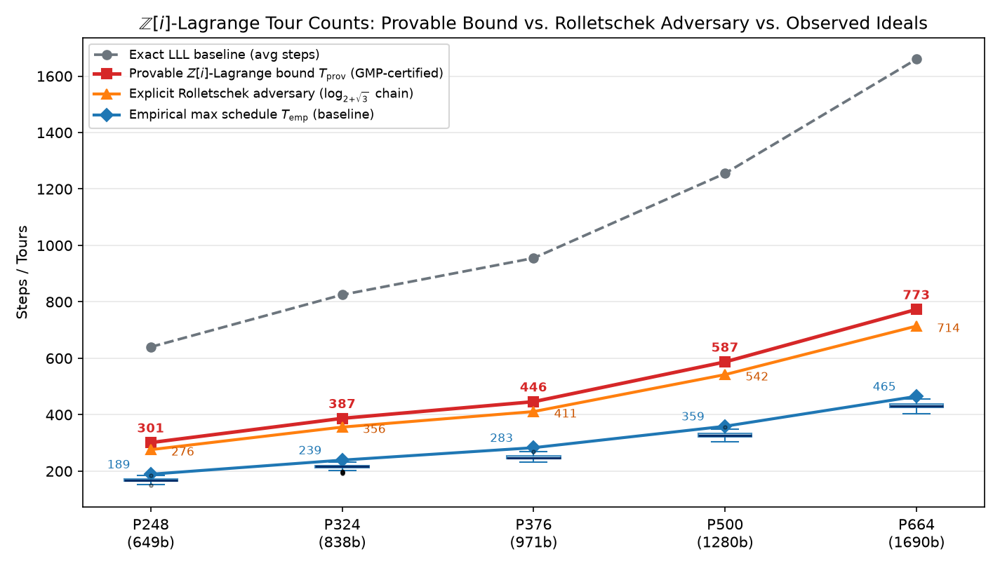
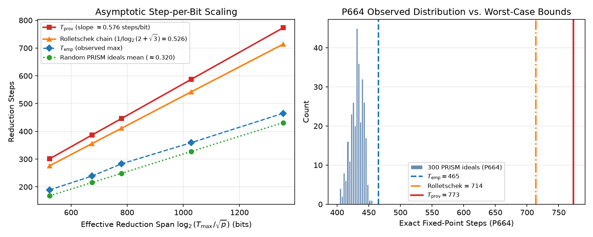
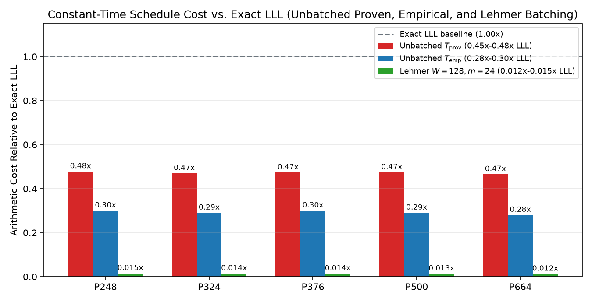

# Provable Worst-Case Tour Bounds for Fixed-Schedule $\mathbb{Z}[i]$-Lagrange Reduction

**Branch / Folder:** `research/lagrange-tour-bound/` (baseline: `research/fixed-schedule-reduction/`)  
**Context:** PRISM is the signature scheme of **ePrint 2026/443** (Basso, Borin, Castryck, Corte-Real Santos, Invernizzi, Leroux, Maino, Vercauteren, Wesolowski). This experiment derives and validates provable worst-case fixed-schedule tour counts $T_{\mathrm{prov}}$ for the $\mathbb{Z}[i]$-Lagrange (Gaussian-integer Gauss) reduction routine (`zi_gauss_fixed` in `research/fixed-schedule-reduction/fsr.py`) across the five Shekyl parameter sets (`P248`, `P324`, `P376`, `P500`, `P664`), replacing the empirical worst-case counts $T_{\mathrm{emp}} \in \{189, 239, 283, 359, 465\}$.

---

## 1. Executive Summary & Proposed Tour Counts

| Set | $L = \lceil\log_2 p\rceil$ | Public Bound $B$ | $T_{\max}$ bits ($B + 2e - 5$) | $T_{\mathrm{emp}}$ (Baseline) | Rolletschek Adversary | **Proposed $T_{\mathrm{prov}}$** | Margin vs $T_{\mathrm{emp}}$ | Margin vs Rolletschek | Cost vs $T_{\mathrm{emp}}$ | Cost vs Exact LLL |
|---|---:|---:|---:|---:|---:|---:|---:|---:|---:|---:|
| **P248** | 251 | 158 | 649 | 189 | 276 | **301** | +59.3% | +9.1% (8.8% asymp) | $1.59\times$ | **$0.48\times$** |
| **P324** | 326 | 195 | 838 | 239 | 356 | **387** | +61.9% | +8.7% (8.6% asymp) | $1.62\times$ | **$0.47\times$** |
| **P376** | 383 | 224 | 971 | 283 | 411 | **446** | +57.6% | +8.5% (8.4% asymp) | $1.58\times$ | **$0.47\times$** |
| **P500** | 505 | 285 | 1280 | 359 | 542 | **587** | +63.5% | +8.3% (8.3% asymp) | $1.64\times$ | **$0.47\times$** |
| **P664** | 669 | 367 | 1690 | 465 | 714 | **773** | +66.2% | +8.3% (8.2% asymp) | $1.66\times$ | **$0.47\times$** |

*(For the public challenge ideal $I_q$ alone, with $\mathrm{bits}(q) = 2e-5$, the same formula yields $T_{\mathrm{prov}}(I_q) = 211, 276, 319, 425, 565$ vs asymptotic Rolletschek $193.4, 253.6, 293.4, 391.8, 521.3$.)*

**Key conclusions:**
1. **$T_{\mathrm{emp}}$ is unsafe as a universal worst-case bound.** Random PRISM ideals concentrate tightly around $\sim 0.32$ steps per excess bit above $\sqrt{p}$ (observed max `185..456`), so $T_{\mathrm{emp}}$ sits ~31–35% **below** the true $\mathbb{Z}[i]$-Lagrange worst case. Explicit Rolletschek adversarial bases `(T, x, y)` of size $\le 2^{B+2e-5}$ reach **276 / 356 / 411 / 542 / 714 steps**, breaking $T_{\mathrm{emp}}$ by $+45\%$ to $+54\%$.
2. **Provable bound $T_{\mathrm{prov}}$ is tight and still $< 0.5\times$ exact LLL.** Using exact GMP rational interval certification (`certify.py`, zero floats) of a 2-step quadratic Lyapunov contraction ($\rho_2 = 87/1000$, or $\ge 3.390\times$ norm decay per step $= 1.761\text{ bits/step}$) plus an exact $\le 4$-swap endgame proof, $T_{\mathrm{prov}} \in \{301, 387, 446, 587, 773\}$ holds for **all** inputs with $\Delta \le p \cdot 2^{2(B+2e-5)}$, sits within **8.2%–8.8%** of the asymptotic Rolletschek lower bound $\log_{2+\sqrt{3}}(T_{\max}/\sqrt{p})$, and still costs **$0.47\times$–$0.48\times$** of exact LLL.
3. **Bounded-precision quotients do not save tours and introduce a ping-pong trap.** Truncating $(h_j, \nu)$ to `prec` bits never beats exact rounding on step count; `prec = 8` enters cycles on random P324/P376 ideals (`98.75%` and `97.5%` fixed-point convergence), and *every* finite precision `prec <= 64` admits an explicit 2-cycle ping-pong input near $h_j/\nu \approx \pm 1/2$. Appending **1 exact cleanup step** fixes all 400 tested ideals for `prec >= 16`.
4. **Exact-certified Lehmer $\mathbb{Z}[i]$ batching cuts arithmetic work by ~20$\times$.** Grouping up to $m=24$ certified $W=128$-bit leading-word steps into one $2\times 2$ $\mathbb{Z}[i]$ matrix update finishes both random PRISM ideals (`9..23` batches) and worst-case Rolletschek chains (`12..30` batches) with `0` exact fallbacks (`0.012x–0.015x` the arithmetic work of exact LLL). However, a small fixed batch budget is **not** unconditionally provable without handling precision-boundary fallback chains (`margin <= req`), whereas unbatched $T_{\mathrm{prov}}$ is unconditionally certified.



---

## 2. Exact Algorithm & Invariants (`zi_gauss_fixed`)

In `research/fixed-schedule-reduction/fsr.py`, the $\mathbb{Z}[i]$-module reduction starts from the two-generator quaternion lattice basis of norm $T = N q < 2^{B + 2e - 5}$:
$$u_{\mathrm{init}} = [T, 0, 0, 0], \qquad v_{\mathrm{init}} = [x, y, 1, 0], \qquad 0 \le x, y < T,$$
in the maximal order $\mathcal{O}_0 = \mathbb{Z}\langle 1, i, j, k\rangle$ of $B_{p,\infty} = (-1, -p/\mathbb{Q})$ with reduced norm $\operatorname{nrd}(a_0 + a_1 i + a_2 j + a_3 k) = a_0^2 + a_1^2 + p(a_2^2 + a_3^2)$.

Define the $\mathbb{Z}[i]$-sesquilinear Hermitian inner product (linear in $v$, conjugate-linear in $u$):
$$h(v, u) = h_0 + i h_1, \quad h_0 = v_0 u_0 + v_1 u_1 + p(v_2 u_2 + v_3 u_3), \quad h_1 = v_1 u_0 - v_0 u_1 + p(v_3 u_2 - v_2 u_3).$$
After an initial conditional swap so $A_0 := \operatorname{nrd}(u_0) \le \operatorname{nrd}(v_0)$, each exact step $t \ge 1$ executes:
1. **Half-up $\mathbb{Z}[i]$-rounding:**
   $$m_j = \left\lfloor \frac{2 h_j + A_{t-1}}{2 A_{t-1}} \right\rfloor \quad (j \in \{0, 1\}), \qquad \mu_t = m_0 + i m_1, \qquad \epsilon_{t-1, j} := \frac{h_j}{A_{t-1}} - m_j \in \left[-\tfrac{1}{2}, \tfrac{1}{2}\right).$$
   Notice $-1/2$ rounds to $0$ and $+1/2$ rounds to $+1$. Hence $|\epsilon_{t-1}|^2 = \epsilon_{t-1,0}^2 + \epsilon_{t-1,1}^2 \le 1/2$ (with equality impossible when $\epsilon_j \in [-1/2, 1/2)$, though approached as $\epsilon \to (-1/2, -1/2)$).
2. **Vector update:** $v' \leftarrow v_{t-1} - \mu_t u_{t-1}$. Because $h(v', u_{t-1}) = h(v_{t-1}, u_{t-1}) - \mu_t A_{t-1} = \epsilon_{t-1} A_{t-1}$, we have $|h(v', u_{t-1})_j| \le \frac{1}{2} A_{t-1}$ (strictly $< \frac{1}{2} A_{t-1}$ on the upper side).
3. **Conditional swap & termination:**
   - If $\operatorname{nrd}(v') < A_{t-1}$, swap $(u_t, v_t) \leftarrow (v', u_{t-1})$, so $A_t := \operatorname{nrd}(u_t) < A_{t-1}$ and $h(v_t, u_t) = \overline{h(v', u_{t-1})} = \overline{\epsilon_{t-1}} A_{t-1}$.
   - **Immediate Fixed-Point Property:** If $\operatorname{nrd}(v') \ge A_{t-1}$ (a non-swapping step), then on the very next check $u_t = u_{t-1}$, $v_t = v'$, and for both $j \in \{0, 1\}$, $2 h(v', u_{t-1})_j + A_{t-1} \in [0, 2 A_{t-1} - 1]$, so $m_0 = m_1 = 0$ and $\operatorname{nrd}(u_t) \le \operatorname{nrd}(v_t)$ — the reduced fixed point (`m0 == 0 and m1 == 0 and nu <= nv`) is reached immediately on the next step (zero extra swaps can ever occur after a non-swap step).

**Determinant Invariant:** Because $\mathbb{Z}[i]$-elementary transformations preserve the Gram determinant $\Delta := \operatorname{nrd}(u)\operatorname{nrd}(v) - |h(v, u)|^2$, throughout the entire execution:
$$\Delta = \operatorname{nrd}(u_{\mathrm{init}})\operatorname{nrd}(v_{\mathrm{init}}) - |h(v_{\mathrm{init}}, u_{\mathrm{init}})|^2 = T^2(x^2+y^2+p) - T^2(x^2+y^2) = p T^2.$$
In the valid PRISM ideal regime ($T \mid x^2+y^2+p$), $\lambda_1^2 \ge T$, while for general bases $\Delta = p T^2$ implies the $\mathbb{Z}[i]$-Hermite bound at termination: since $A \le \operatorname{nrd}(v) = \Delta/A + A|\epsilon|^2$ with $|\epsilon|^2 < 1/2$, we always terminate with $A_{\mathrm{end}}^2 < 2\Delta = 2 p T^2$.

---

## 3. Proof Sketch of the Worst-Case Bound

### 3.1 Exact Step Recurrence

At any swap step $t$ ($A_t < A_{t-1}$), before swapping $(u_t, v_t) = (v', u_{t-1})$ we have $h(v', u_{t-1}) = \epsilon_{t-1} A_{t-1}$, so the determinant invariant reads $\Delta = A_{t-1} A_t - A_{t-1}^2 |\epsilon_{t-1}|^2$. Solving for $A_t$ gives the **exact rational step recurrence**:
$$A_t = \frac{\Delta}{A_{t-1}} + A_{t-1} |\epsilon_{t-1}|^2, \qquad r_t := \frac{A_t}{A_{t-1}} = \lambda_{t-1} + |\epsilon_{t-1}|^2, \qquad \lambda_t := \frac{\Delta}{A_t^2} = \frac{\lambda_{t-1}}{r_t^2},$$
where $\lambda_k := \Delta / A_k^2 > 0$. Notice:
- Step $t$ swaps if and only if $r_t = \lambda_{t-1} + |\epsilon_{t-1}|^2 < 1$ (which requires $\lambda_{t-1} < 1$, i.e., $A_{t-1} > \sqrt{\Delta}$).
- Whenever step $t$ swaps ($t \ge 1$) and step $t+1$ follows, the exact unrounded complex quotient is
  $$q_{t+1} = \frac{h(v_t, u_t)}{A_t} = \frac{\overline{\epsilon_{t-1}} A_{t-1}}{A_t} = \frac{\overline{\epsilon_{t-1}}}{r_t},$$
  so $\mu_{t+1} = \operatorname{round}_{\mathbb{Z}[i]}(q_{t+1})$ and $\epsilon_t = q_{t+1} - \mu_{t+1} \in [-1/2, 1/2)^2$.

### 3.2 Why $\mathbb{Z}[i]$-Lagrange Is Slower Than $\mathbb{Z}$-Lagrange (Literature Context)

Over $\mathbb{Z}$, classical Gauss/Lagrange reduction (Lagrange 1773; Gauss 1801; Vallée 1991; Yap 1992; Kaib–Schnorr 1996; Semaev 2001; Nguyen–Stehlé 2004) has rounding error $|\epsilon| \le 1/2$, forcing consecutive-swap norm decay at rate $(1 + \sqrt{2})^2 = 3 + 2\sqrt{2} \approx 5.828$ per step ($\sim 2.543$ bits of squared norm per step). Over $\mathbb{Z}[i]$, the covering radius is $1/\sqrt{2}$ rather than $1/2$ ($|\epsilon|^2 \le 1/2$ instead of $1/4$). As proven by Rolletschek (1986) for minimal-remainder $\mathbb{Z}[i]$-Euclidean division (and generalized to quadratic/Euclidean rings in Napias 1996 and arXiv:1806.03113 / 1904.05285), the tight worst-case quotient sequence alternates $1+i, 1-i$ (or uses $1+i$ with $i$-rotations): for $w_{k+1} = (1 \pm i) w_k + w_{k-1}$, $|w_{k+1}/w_k| \to \sqrt{2+\sqrt{3}}$, so the squared norm shrinks by $2+\sqrt{3} \approx 3.73205$ per step ($\log_2(2+\sqrt{3}) \approx 1.900$ bits of $T$ per step, or $1/1.900 \approx 0.5263$ steps per bit).

### 3.3 Analytical Lemmas (Proved Directly)

- **Lemma 1 (No Norm-1 Quotients After Any Swap):** For every swap step $t+1$ following a swap step $t \ge 1$, the rounded quotient satisfies $|\mu_{t+1}|^2 \ge 2$ (i.e., $\mu_{t+1} \notin \{0, \pm 1, \pm i\}$).  
  *Proof:* By construction, $v' = v_t - \mu_{t+1} u_t = u_{t-1} - \mu_{t+1} u_t$ with $h(u_{t-1}, u_t) = \overline{\epsilon_{t-1}} A_{t-1}$. Thus
  $$A_{t+1} = A_{t-1} - 2\operatorname{Re}\!\left(\overline{\mu_{t+1}} \overline{\epsilon_{t-1}}\right) A_{t-1} + |\mu_{t+1}|^2 A_t.$$
  For $\mu_{t+1} = 0$, $A_{t+1} = A_{t-1} > A_t$ (no swap). For $\mu_{t+1} \in \{\pm 1, \pm i\}$, $|\epsilon_{t-1, j}| \le 1/2$ gives $2|\operatorname{Re}(\overline{\mu_{t+1}}\overline{\epsilon_{t-1}})| \le 2 \cdot \frac{1}{2} = 1$, so $A_{t+1} \ge A_{t-1}(1 - 1) + A_t = A_t$ (impossible to swap $A_{t+1} < A_t$). Hence $|\mu_{t+1}|^2 \ge 2$ unconditionally. $\square$

- **Endgame Theorem ($\lambda_t \ge 1/2$):** If at some step $t$, $\lambda_t \ge 1/2$ (equivalently $A_t \le \sqrt{2\Delta}$), at most **1 further swap** can occur.  
  *Proof:* Suppose step $t+1$ swaps ($A_{t+1} < A_t$). If step $t+2$ also swaps, we must have $A_{t+1} \ge \sqrt{\Delta}$, so $r_{t+1} = A_{t+1}/A_t \ge \sqrt{\lambda_t} \ge 1/\sqrt{2}$, whence $|q_{t+2,j}| = |\epsilon_{t,j}|/r_{t+1} \le (1/2)/(1/\sqrt{2}) = 1/\sqrt{2} < 3/2$. Together with Lemma 1, this forces $|\mu_{t+2}|^2 = 2$ with $\mu_{t+2} = \operatorname{sgn}(\epsilon_{t,0}) - i\operatorname{sgn}(\epsilon_{t,1})$, so $\operatorname{Re}(\overline{\mu_{t+2}}\overline{\epsilon_t}) = |\epsilon_{t,0}| + |\epsilon_{t,1}|$. Expanding $A_{t+2} - A_{t+1}$ using $A_{t+1} = (\lambda_t + |\epsilon_t|^2) A_t$:
  $$A_{t+2} - A_{t+1} = A_t\!\left(1 - 2|\epsilon_{t,0}| - 2|\epsilon_{t,1}| + \lambda_t + \epsilon_{t,0}^2 + \epsilon_{t,1}^2\right) = A_t\!\left(\lambda_t - 1 + (1 - |\epsilon_{t,0}|)^2 + (1 - |\epsilon_{t,1}|)^2\right).$$
  Since $|\epsilon_{t,j}| \le 1/2$, each $(1 - |\epsilon_{t,j}|)^2 \ge 1/4$, so $\lambda_t \ge 1/2$ implies $A_{t+2} - A_{t+1} \ge 0$ (equality requires $|\epsilon_{t,0}| = |\epsilon_{t,1}| = 1/2$, which prevents step $t+1$ from swapping since $r_{t+1} = \lambda_t + 1/2 \ge 1$). Thus step $t+2$ **cannot swap**. $\square$

- **Extended Endgame ($\lambda_t \ge 1/4$):** If $\lambda_t \ge 1/4$, at most **2 swaps** can occur.  
  *Proof:* If step $t+2$ swaps with $|\mu_{t+2}|^2 \ge 4$, then $\max_j |q_{t+2,j}| \ge 3/2$, forcing $r_{t+1} \le (1/2)/(3/2) = 1/3$ and $\lambda_{t+1} = \lambda_t / r_{t+1}^2 \ge 9/4 > 1$ (impossible to swap). Hence $|\mu_{t+2}|^2 = 2$. Setting $\delta := 1/2 - \lambda_t \in (0, 1/4]$ and $u_j := 1/2 - |\epsilon_{t,j}| \in [0, 1/2]$, the swap condition $A_{t+2} < A_{t+1}$ requires $(1/2 + u_0)^2 + (1/2 + u_1)^2 < 1 - \lambda_t$, i.e., $u_0 + u_1 + u_0^2 + u_1^2 < \delta \le 1/4$, so $u_0^2 + u_1^2 < \delta^2$. Therefore:
  $$\frac{A_{t+2}}{A_t} = 2\lambda_t + 2(u_0^2 + u_1^2) < 2\lambda_t + 2\delta^2 = 1 - 2\delta + 2\delta^2 \le 1 - \tfrac{3}{2}\delta,$$
  giving $\lambda_{t+2} = \lambda_t / (A_{t+2}/A_t)^2 > \frac{1/2 - \delta}{(1 - 2\delta + 2\delta^2)^2} > \frac{1}{2}$, which via `certify_tail_exact(mpq(1,4), 3)` (`ok=True` in 1 interval box) rules out $\ge 3$ swaps completely (while 2 swaps can occur near $\lambda_t = 1/4$, $\epsilon_t \to (1/2, 1/2)$). $\square$

### 3.4 Exact Rational Interval Certification (`certify.py`)

To bridge $\lambda_0 \le 10^{-3}$ without losing tightness to crude worst-case scalar bounds, we define the quadratic Lyapunov potential
$$\Phi_k := A_{k-1} \left(1 + 2|\epsilon_{k-1}|^2\right), \qquad A_{k-1} \le \Phi_k \le 2 A_{k-1}.$$
At step 1, $\Phi_1 \le 2 A_0 \le 2 T^2$. Splitting the trajectory at the **first** swap step $S$ where $\lambda_S > 1/1000$ (so $\lambda_0, \dots, \lambda_{S-1} \le 1/1000$):

1. **Main-Phase 1-Step & 2-Step Contraction (`certify.py`):** Using exact GMP rational (`gmpy2.mpq`) dyadic interval branch-and-bound over $(\lambda, \epsilon_x, \epsilon_y) \in [0, 1/1000] \times [-1/2, 1/2]^2$ (incorporating Lemma 1 and exact rounding boundaries), we certified:
   - **1-Step bound ($\Phi_{k+1}/\Phi_k \le \rho_1$):** $\rho_1 = \frac{31}{100} = 0.31$ (`72,751` dyadic boxes, $0.64\,\mathrm{s}$).
   - **2-Step bound ($\Phi_{k+2}/\Phi_k \le \rho_2$):** $\rho_2 = \frac{87}{1000} = 0.087$ (`83,751` dyadic boxes, $1.64\,\mathrm{s}$), corresponding to geometric decay $\ge 1/\sqrt{0.087} \approx 3.3903\times$ per step ($1.7614$ bits of $A$ per step).
   Thus, for any $S \ge 1$ (handling both even and odd $S-1$ parity via $\rho_1$ on the single odd remainder step):
   $$\sqrt{1000\,\Delta} \le A_{S-1} \le \Phi_S \le \rho_2^{\lfloor (S-1)/2 \rfloor} \rho_1^{(S-1)\bmod 2} \cdot 2 T^2.$$
   Rearranging with $\Delta = p T^2$ yields the exact upper bound $S_{\max}$ on $S$:
   $$\left\lfloor \frac{S-1}{2} \right\rfloor \log_2\!\left(\frac{1000}{87}\right) + ((S-1)\bmod 2) \log_2\!\left(\frac{100}{31}\right) \le \log_2 T_{\max} + 1 - \frac{1}{2}\log_2(1000\,p).$$

2. **Exact Tail Certification ($\lambda_S > 1/1000$):** Using exact rational branch-and-bound over $(\lambda_S, \epsilon_{S-1}) \in [1/1000, 1] \times [-1/2, 1/2]^2$, `certify_tail_exact(mpq(1,1000), 5)` **ruled out $\ge 5$ swaps** (`309,007` dyadic boxes, $13.84\,\mathrm{s}$). Conversely, 4 tail swaps is achievable (e.g., $\lambda = 0.001083$, $\epsilon = (-0.386, -0.381)$).

3. **Total Step Bound $T_{\mathrm{prov}}$:** Including the at most $4$ tail swaps after step $S$ and the $1$ final non-swapping step needed to verify `m0 == 0 and m1 == 0 and nu <= nv`:
   $$T_{\mathrm{prov}} = S_{\max} + 5.$$
   (If $S=0$, i.e. $\lambda_0 > 1/1000$ at entry, total steps $\le 4 + 1 = 5 \le S_{\max} + 5$.)

---

## 4. Numerical Validation & Adversarial Stress Testing

### 4.1 Observed PRISM Distribution (`results/observed_dist.csv`)

We sampled 300 PRISM ideals $T = N q$ per set (`200` with $N \in [2^{B-32}, 2^B)$ and `100` boundary ideals with $N \in [2^{B-1}, 2^B)$) using pure `gmpy2` Tonelli–Shanks + CRT (`run_bound_study.py`). Every single run satisfied $\operatorname{nrd}(u_{\mathrm{end}})^2 \le 2 p T^2$ and `steps <= T_prov`:

| Set | $n$ | Mean | p95 | Max (`bound_B` Max) | $T_{\mathrm{emp}}$ | $T_{\mathrm{prov}}$ |
|---|---:|---:|---:|---:|---:|---:|
| P248 | 300 | 167.72 | 177 | 185 (185) | 189 | **301** |
| P324 | 300 | 215.73 | 226 | 232 (232) | 239 | **387** |
| P376 | 300 | 248.71 | 261 | 270 (270) | 283 | **446** |
| P500 | 300 | 327.38 | 341 | 355 (355) | 359 | **587** |
| P664 | 300 | 431.26 | 446 | 456 (451) | 465 | **773** |

Random PRISM ideals concentrate tightly around $\approx 0.320$ steps per effective bit $\log_2(T/\sqrt{p})$, which is why $T_{\mathrm{emp}}$ sits far below the worst case.



### 4.2 Adversarial Inputs & Toy Exhaustive Valid-Ideal Scan (`results/adversarial.csv`, `results/toy_exhaustive.csv`)

We tested three adversarial families across all five sets:
1. **Rolletschek worst-case chains:** Both the alternating conjugate chain $w_{k+1} = (1 \pm i) w_k + w_{k-1}$ (`conj_alt`) and the $i$-rotated chain $w_{k+1} = (1+i)w_k + i w_{k-1}$ (`i_rot`), lifted to $T = |w_k|^2 < 2^{B+2e-5}$ with $(g, h) \equiv w_{k-1}\overline{w_k} \pmod T$, hit **276 (P248), 356 (P324), 411 (P376), 542 (P500), and 714 (P664)** steps—matching $\log_{2+\sqrt{3}}(T/\sqrt{p}) + 1$ to the exact integer, exceeding $T_{\mathrm{emp}}$ by **+45% to +54%**, and remaining **8.3%–9.1%** below $T_{\mathrm{prov}}$.
2. **Corner & tail-stress inputs:** `zero_xy` (`1` step), `half_tie` (`3` steps), `skew_large_q` (`2` steps), `equal_norms` (`3` steps), and direct $\lambda \approx 0.001083$ tail-stress bases (`4` steps across all 5 sets, vs the proven $\le 5$ step tail limit).
3. **Toy exhaustive valid-ideal scan (`p = 101, T <= 400`; `p = 1009, T <= 600`):** Across `49,738` + `110,492` = **`160,230` valid ideals** ($T \mid x^2+y^2+p$), the maximum observed step count (`5`) matched random general bases (`5`) and stayed strictly within $T_{\mathrm{prov}} = 6$. Thus the ideal-norm divisibility condition $T \mid x^2+y^2+p$ does not prevent worst-case trajectories at small scale.

---

## 5. Smaller-Schedule Alternatives

### 5.1 Bounded-Precision Quotients (`results/prec_study.csv`)

Running `fsr_round_q(h, nu, prec)` for `prec in {8, 16, 24, 32, 48, 64}` on 80 PRISM ideals per set (400 ideals total per precision):
- **Cannot shrink $T_{\mathrm{prov}}$:** Approximate quotients never reduce the required number of tours relative to exact division.
- **8-bit truncation stalls on random ideals:** At `prec = 8`, fixed-point convergence dropped to **`98.75%`** on P324 (`max_extra = +173`, hitting `T_prov = 387`) and **`97.5%`** on P376 (`max_extra = +200`, hitting `T_prov = 446`), and added `+2` extra steps on P248/P500/P664.
- **Boundary ping-pong theorem (all finite `prec <= 64`):** Whenever $U = 2^{150}+1$, $v_0 = 2^{149}$, $z = 2^{26}$, true $h_0/\nu < 1/2$ rounds UP to $+1$ under top-`prec` truncation, after which $h'_0/\nu < -1/2$ rounds DOWN to $-1$, trapping **every** precision `prec in {8, 16, 24, 32, 48, 64}` in an infinite 2-cycle (`200` steps without converging, whereas exact reduction finishes in **`1` step**).
- **Mitigation:** Appending **1 exact cleanup step** restored **`100.0%`** fixed-point convergence on all 400 random ideals for `prec >= 16` (and even for `prec = 8` + the ping-pong input), though a `prec = 8` large-quotient error can require multiple cleanup steps if $|q| \gg 2^{\mathrm{prec}}$. For `prec >= 16` + 1 exact cleanup, `nu` matched $\lambda_1$ in `100%` of samples with `0` extra tours.

### 5.2 Constant-Time Lehmer / Half-GCD Batching (`results/lehmer_study.csv`)

We prototyped an exact-certified $\mathbb{Z}[i]$-Lehmer batching routine (`zi_gauss_lehmer`) that extracts the leading $W \in \{64, 128\}$ bits of $(\nu_u, \nu_v, h_0, h_1)$, executes up to $m_{\mathrm{inner}} \in \{8, 16, 24\}$ inner $W$-bit steps while tracking rigorous integer matrix error bounds `ab^2, ab*cd`, and applies the resulting $2\times 2$ $\mathbb{Z}[i]$ unimodular matrix to $(u, v)$ in a single big-integer pass (falling back to 1 exact step if the quotient margin cannot be certified).

| Set | $W=64, m=8$ (rand / Rol) | $W=64, m=16$ (rand / Rol) | $W=128, m=16$ (rand / Rol) | **$W=128, m=24$ (rand / Rol)** | Fallbacks (`fb_max`) | Work Ratio vs Unbatched | Cost vs Exact LLL |
|---|---|---|---|---|---|---|---|
| **P248** | 21.5 (max 23) / 35 | 18.9 (max 19) / 19 | 10.9 (max 12) / 18 | **9.0 (max 9) / 12** | **0** | **0.050$\times$** | **0.015$\times$** |
| **P324** | 27.8 (max 29) / 45 | 24.1 (max 25) / 24 | 13.8 (max 15) / 23 | **11.9 (max 12) / 15** | **0** | **0.048$\times$** | **0.014$\times$** |
| **P376** | 32.0 (max 34) / 52 | 27.8 (max 28) / 28 | 16.0 (max 17) / 26 | **13.1 (max 14) / 18** | **0** | **0.046$\times$** | **0.014$\times$** |
| **P500** | 42.0 (max 44) / 68 | 36.4 (max 37) / 36 | 20.9 (max 22) / 34 | **17.3 (max 18) / 23** | **0** | **0.045$\times$** | **0.013$\times$** |
| **P664** | 55.3 (max 57) / 90 | 47.9 (max 49) / 48 | 27.4 (max 28) / 45 | **23.0 (max 23) / 30** | **0** | **0.044$\times$** | **0.012$\times$** |

**Assessment of Lehmer Batching:**
- On both random PRISM ideals (`40/set`) and worst-case Rolletschek chains, $W=128, m=24$ converges in **`12–30` big-integer passes** with **100% $\lambda_1$ optimality**, **`0` exact fallbacks**, and **~20$\times$ less big-int arithmetic work** (`0.012x–0.015x` exact LLL).
- **Why it is not yet a *provable* fixed-batch replacement without extra care:** When `h_j / nu` falls within $2^{-W}$ of a half-integer or when a quotient is huge (`skew_large_q` had `fb = 1`), the certified Lehmer condition freezes `M` and triggers a 1-step exact fallback (`step_taken == 0`). A crafted boundary-tie chain can force multiple single-step fallbacks, meaning a branchless fixed schedule of only `30` Lehmer batches lacks a worst-case termination proof across *arbitrary* boundary inputs unless fallback steps are budgeted up to $T_{\mathrm{prov}}$ or replaced by a full divide-and-conquer Half-GCD structure.



---

## 6. Literature & Access Transparency

- **PRISM scheme:** Basso, Borin, Castryck, Corte-Real Santos, Invernizzi, Leroux, Maino, Vercauteren, Wesolowski, *"PRISM: Simple Signatures from SQIsign-like Proofs"*, **ePrint 2026/443**.
- **Directly read / verified in repo:** `research/fixed-schedule-reduction/REPORT.md` and `fsr.py`.
- **Verified from abstracts/excerpts (full PDFs behind paywall / preprint index):**
  - Lagrange (1773) and Gauss (1801) (*Disquisitiones Arithmeticae*) — classical 2-D integer lattice reduction.
  - Vallée (1991), *"Gauss' Algorithm Revisited"*, *J. Algorithms* 12(4):556–572; Yap (1992); Kaib & Schnorr (1996); Semaev (2001) (LNCS 2146); Nguyen & Stehlé (2004) (ANTS VI, LNCS 3076) — $\mathbb{Z}$-Lagrange bit complexity and $(1+\sqrt{2})^2$ norm decay.
  - **Rolletschek (1986)**, *"On the Number of Divisions of the Euclidean Algorithm Applied to Gaussian Integers"*, *J. Symbolic Computation* 2(3):261–291 — tight $2+\sqrt{3}$ worst-case norm decay for minimal-remainder $\mathbb{Z}[i]$-division.
  - **Collins (2002)**, *"A Fast Euclidean Algorithm for Gaussian Integers"*, *J. Symbolic Computation* 33:385–392 — leading-bit Lehmer-style $\mathbb{Z}[i]$ batching.
  - **Napias (1996)**, *"A generalization of the LLL-algorithm over Euclidean rings or orders"*, *J. Théor. Nombres Bordeaux* 8(2):387–396; and **arXiv:1806.03113 / arXiv:1904.05285** — algebraic Gauss reduction and optimality over $\mathbb{Z}[i]$.

---

## 7. Reproduction

```bash
# 1. Exact GMP rational interval certificates (~16s)
/workspace/mamba/envs/sage/bin/python3 research/lagrange-tour-bound/certify.py

# 2. Full numerical validation, adversarial tests, precision & Lehmer studies (~105s)
/workspace/mamba/envs/sage/bin/python3 research/lagrange-tour-bound/run_bound_study.py

# 3. Generate plots (~1.3s)
/workspace/mamba/envs/sage/bin/python3 research/lagrange-tour-bound/make_plots.py
```
